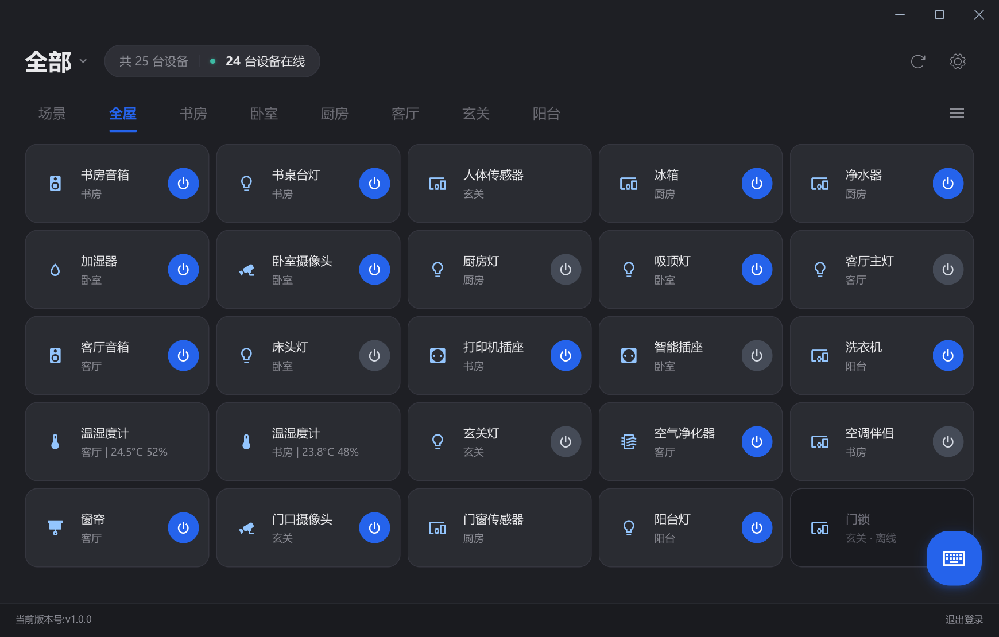
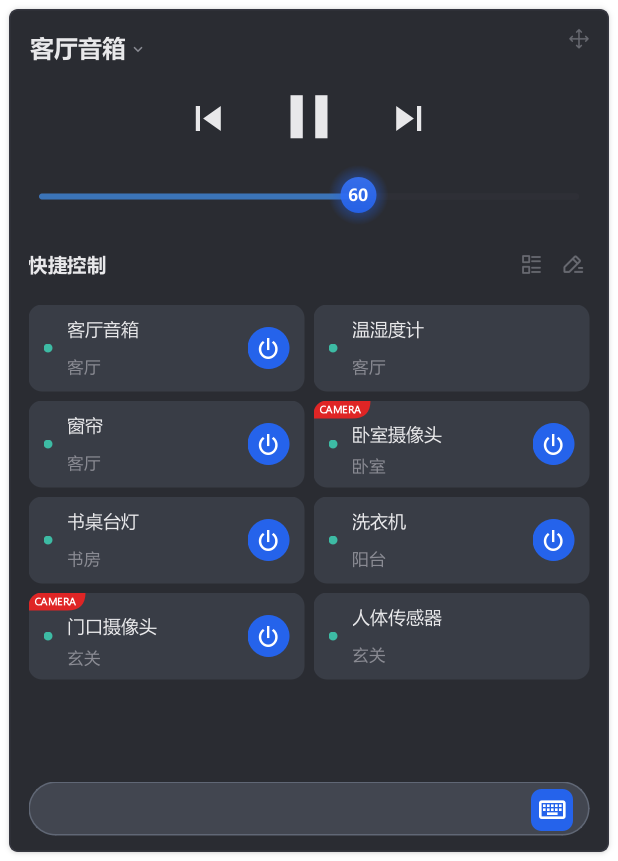

<p align="center"></p>

# MijiaDeck · 米家 / 小米智能设备 Windows 桌面控制台

**让米家智能设备，在 Windows 上更方便地查看、管理和控制。**

MijiaDeck 是面向 Windows 的第三方米家桌面客户端。把常用设备放进卡片和系统托盘，在电脑上开关灯、查看温湿度、执行手动场景，或者向小爱同学发送文字指令，减少反复拿起手机的步骤。

**A Windows desktop dashboard for Xiaomi Mi Home (Mijia).** Manage smart-home devices, pin quick controls to the system tray, run scenes and send text commands to XiaoAI — with light/dark themes and custom accent colors. The current interface is primarily in Chinese.

基于 [MiHome-Windows](https://github.com/huanyuejue/MiHome-Windows) 改进，延续 GPL-3.0-or-later 许可证并保留上游署名。MijiaDeck 与小米、米家官方没有隶属关系。

## 界面预览 / Screenshots

以下截图使用实际界面和**虚构示例数据**渲染，不包含真实账号、家庭或摄像头画面。设备种类仅为界面演示，不代表全部型号均已适配。

### 浅色模式 / Light mode


### 深色模式 / Dark mode



### 托盘快捷控制 / System tray quick controls

<p></p>

## 为什么做 MijiaDeck

坐在电脑前时，开关设备、查看房间状态等操作，也应该能直接在桌面完成。

- **桌面设备卡片**：按家庭和房间查看设备，区分在线状态和开关状态；支持的温湿度设备直接显示读数。
- **房间导航**：横向滚动和拖动浏览房间；右侧列表可直接跳转，并显示对应设备数量。
- **托盘快捷操作**：把常用设备和手动场景放进托盘，不必每次打开主窗口；支持单列、双列和排序。
- **可移动的托盘悬浮窗**：拖动顶部空白区调整位置，重启后记忆；托盘右键可还原窗口位置。
- **小爱同学文字指令**：输入“打开客厅灯”等指令，主窗口和托盘跟随同一个默认小爱音箱。
- **音箱控制**：在托盘查看、调整音量，使用设备支持的播放、暂停和切歌功能。
- **远程摄像头预览（实验性）**：在电脑上查看兼容米家摄像头的实时画面，拖动画面调整云台角度；支持画质切换、静音和全屏。需额外摄像头组件，首发公开便携包暂不附带，详见下文。
- **适应日常使用的界面**：浅色、深色、跟随系统；四种主题色和自定义 HEX 色值；支持高 DPI 和界面缩放调整。
- **清晰的状态反馈**：底栏显示当前版本；刷新设备时暂时切换为获取状态；支持退出登录。

摄像头界面和远程预览为可选实验功能，组件分发状态见下文。不同设备实际可用功能取决于其型号、米家接口和固件。

## 支持系统 / System requirements

| 项目 | 说明 |
|---|---|
| 目标系统 | Windows 10 1809 及以上、Windows 11，64 位 x64 |
| Win7 / Win8 | 不支持当前版本 |
| ARM Windows | 暂不提供原生 ARM64 发布包 |
| 高 DPI | 跟随 Windows 缩放，并可在设置中额外调整 |
| 网络 | 登录、设备控制及相关云端功能需要联网 |
| 源码环境 | Python >= 3.10；当前开发环境为 Python 3.12 / PySide6 6.8.3 |

系统范围依据当前 Qt 6.8 的平台要求确定；Windows 11 的完整实机回归尚待补充，不代表所有设备型号均已经过测试。

## 下载和使用 / Download & use

首发版本为 **v1.0.0**，提供 **Windows x64 绿色免安装 ZIP**。[前往 Releases 下载](https://github.com/Songmanual/MijiaDeck/releases)。请选择 `MijiaDeck-v1.0.0-windows-x64.zip`；GitHub 自动提供的 `Source code` 是源码，不是可直接运行的软件。

1. 下载并解压完整压缩包。
2. 运行目录中的 `MijiaDeck.exe`，无需安装 Python。
3. 使用米家 APP 扫码登录。
4. 在设置和托盘“编辑卡片”中选择自己的常用设备。

不要只复制 EXE：旁边的 `_internal` 文件夹包含运行所需的 Qt、Python 和资源。便携包已通过本机隔离用户目录、移除 Python 开发路径、中文空格路径解压后的离线检查；这不等同于全新 Windows 虚拟机验证。Win11 完整实机回归、首次扫码登录与真实设备操作仍需要用户反馈。

### “绿色版”和“完全便携”的区别

这里的绿色版指**免安装、不需要管理员权限即可正常启动**。配置和登录凭据保存在当前 Windows 用户目录，移动整个程序目录不会自动把账号带到另一台电脑。

- 应用配置与缓存：`%LOCALAPPDATA%\MijiaDeck\`
- 登录凭据：`~/.config/mijia-api/auth.json`
- 源码运行时的配置：项目根目录

首次运行打包版会从旧版 `MiHome-Windows` 数据目录或旧 EXE 同目录复制已有配置；不删除旧文件、不覆盖 MijiaDeck 已有配置。开机自启动是可选设置，仅打包版提供。

请勿上传 `auth.json`、设备缓存、`settings.json`、`tray.json`、`workbench.json`、`account_profiles.json` 等个人数据文件。

## 摄像头预览 / Experimental camera preview

**坐在电脑前，也能远程看看家里的情况。** 对于兼容型号，在配置摄像头组件后，可从设备卡片打开独立预览窗口，通过公网中继查看实时画面，不要求电脑与摄像头处于同一个局域网。使用方式类似米家 APP 中的实时查看；这是第三方实验实现，并不具备官方 APP 的全部摄像头功能。

- **实时查看与云台控制**：在视频区域按住鼠标拖动，调整兼容云台摄像头的上下、左右角度。
- **独立预览窗口**：支持画质切换、静音和全屏；默认优先流畅画质。
- **减少重复加载**：调整窗口大小、最小化后还原保持当前连接；关闭预览窗口后释放视频连接。
- **连接条件**：摄像头需在线，当前网络允许相应的远程传输；首次授权和中继连接可能需要等待。

**Experimental remote camera viewing for compatible Xiaomi Mi Home cameras.** With the separate camera backend configured, view a live stream over an Internet relay, drag the picture to pan/tilt compatible cameras, switch quality and use fullscreen. Resizing or minimizing the preview keeps the session alive. This is a third-party implementation, not full feature parity with the official Mi Home app. The public portable package does not currently bundle the required backend.

- 当前已测试的型号包括 `chuangmi.camera.029a02`，不承诺所有米家摄像头都支持。
- 云台没有可靠的“到位”反馈，目前采用单次拖动指令、短暂冷却和后续视频帧解锁。
- 远程传输参考 [eugeneRover/micam](https://github.com/eugeneRover/micam)。当前固定源码版本未找到明确分发许可证，**公开便携包暂不能默认附带该组件**；来源注明不替代分发许可确认。
- 本仓库不包含 micam 的源文件、编译 JAR 或 Java 运行时。组件状态和许可确认见 [第三方说明](THIRD_PARTY_NOTICES.md)。

任何演示摄像头画面都应明确标为示意，避免被误认为真实设备录像或型号兼容性证明。

## 从源码运行 / Run from source

进入项目目录后运行 `start.bat`，或手动执行：

```powershell
python -m venv .venv
.venv\Scripts\python.exe -m pip install -e .
.venv\Scripts\python.exe run.py
```

首发便携包使用 PyInstaller 目录模式构建，不需要 C 编译器。建议使用 Python 3.12 x64 / PySide6 6.8.3：

```powershell
.venv\Scripts\python.exe -m pip install pyinstaller==6.16.0 PySide6==6.8.3
.venv\Scripts\python.exe tools/build_portable.py
.venv\Scripts\python.exe tools/test_portable.py
```

产物位于 `dist/portable/`，包含 ZIP 与 SHA256 校验文件。脚本使用资源白名单，不复制个人配置、账号或摄像头 JAR。依赖版本写入包内 `build-info.json`，许可证、源码地址及共享库替换说明见 [依赖源码说明](docs/DEPENDENCY_SOURCES.md)。更新随包许可文本可执行 `python tools/collect_release_licenses.py`。

另一条构建路线是 `build.ps1`（Nuitka standalone 目录版，需要 VS Build Tools 2022）。

重绘品牌图标：`python tools/generate_brand_icons.py`（额外需要 Pillow）。

生成示例截图：`python tools/render_demo_screenshots.py`；脚本使用虚构设备、临时配置和禁用网络的任务执行器，不读取真实登录信息。

## 开源致谢 / Credits

- [huanyuejue/MiHome-Windows](https://github.com/huanyuejue/MiHome-Windows)：原始桌面客户端基础。
- [Do1e/mijia-api](https://github.com/Do1e/mijia-api)：米家账号和设备接口。
- [PySide6-SiliconUI](https://github.com/H1DDENADM1N/PySide6-SiliconUI)：界面组件基础。
- [eugeneRover/micam](https://github.com/eugeneRover/micam)：实验性摄像头远程传输参考；分发许可待确认。
- Qt / PySide6、QtAwesome、NumPy 等基础组件。

完整说明见 [THIRD_PARTY_NOTICES.md](THIRD_PARTY_NOTICES.md)。本项目代码遵循 [GPL-3.0-or-later](LICENSE)，第三方代码和组件遵循各自许可证。
